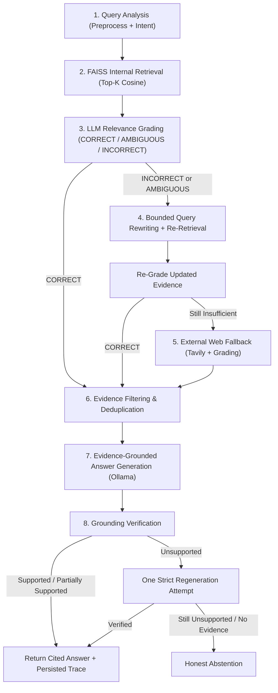

# CRAG AI (NEXUS AI) — Adaptive Corrective Retrieval-Augmented Generation System

An intelligent, domain-agnostic product information and customer support assistant built with **Corrective Retrieval-Augmented Generation (CRAG)**, local LLM inference via **Ollama**, vector search with **FAISS** and **Sentence Transformers**, optional **Tavily** external web fallback, and an interactive **React + Tailwind CSS** SaaS dashboard.

---

## 1. Project Overview

**CRAG AI** (branded **NEXUS AI** in the UI) answers user questions across arbitrary uploaded knowledge bases (PDF, DOCX, TXT, CSV) and external web sources. Rather than trusting vector similarity blindly, the system evaluates whether retrieved evidence actually answers the user's question, rewrites poorly performing queries, falls back to external web search when internal documents are insufficient, filters noisy evidence, and verifies answer grounding before returning a final response.

---

## 2. Problem Statement

Traditional Retrieval-Augmented Generation (RAG) assistants often break in real-world product support and enterprise workflows because:

- **Top-k vector retrieval is noisy**: Cosine similarity often matches surface keywords (for example, matching *"FinServe savings account interest"* when a user asks about *"FinServe home mortgage interest rates"*).
- **Poor user phrasing hides relevant docs**: Informal terms or partial questions miss exact terminology in technical manuals.
- **Static knowledge bases become stale**: Internal documents may lack newly released specifications or out-of-domain answers.
- **Blind generation causes hallucinations**: Passing irrelevant or contradictory chunks to a small local LLM leads to confident fabrication.

---

## 3. Why Normal RAG Is Insufficient

A standard (Basic) RAG pipeline performs just three steps:

1. Embed the user query.
2. Fetch top-*k* nearest neighbors from FAISS.
3. Inject those chunks straight into the LLM prompt.

If the retrieved chunks are off-topic, incomplete, or completely unrelated (for example, an out-of-scope query), Basic RAG has **no mechanism to detect bad retrieval**, **no query correction loop**, **no external fallback**, and **no post-generation grounding audit**.

---

## 4. What CRAG Solves

Adaptive CRAG adds explicit quality-control checkpoints around retrieval and generation:

1. **LLM Relevance Grading**: Grades each chunk individually (`relevant` / `irrelevant`, confidence `0..1`, short explanation) and classifies the retrieval batch as `CORRECT`, `INCORRECT`, or `AMBIGUOUS`.
2. **Corrective Query Rewriting**: When retrieval is `INCORRECT` or `AMBIGUOUS`, rewrites the query (incorporating missing-information hints when partial evidence exists) and performs bounded re-retrieval.
3. **External Web Fallback**: If internal knowledge remains insufficient, queries Tavily Search (when configured) and grades web snippets with the exact same relevance evaluator.
4. **Evidence Filtering & Deduplication**: Removes irrelevant, low-confidence, and duplicate chunks while preserving document names, page numbers, and URLs.
5. **Grounding Verification & Abstention**: Checks generated claims against accepted evidence, allows one strict regeneration if `Unsupported`, and abstains rather than fabricating claims when evidence remains insufficient.

---

## 5. Architecture Diagram



---

## 6. Technology Stack

| Layer | Technology |
| --- | --- |
| **Backend API** | Python 3.11+, FastAPI, Pydantic, SQLite (`sqlite3`) |
| **Vector Search & Embeddings** | FAISS (`IndexIDMap2(IndexFlatIP)`), `sentence-transformers/all-MiniLM-L6-v2` |
| **Document Parsing** | PyMuPDF (`pymupdf`), `python-docx`, Python `csv` |
| **Local LLM & Web Fallback** | Ollama (`llama3.2:3b` default via `/api/chat`), Tavily Search API |
| **Frontend UI** | React, Vite, JavaScript, Tailwind CSS, Lucide React, Recharts, `react-markdown` |
| **Testing & Evaluation** | `pytest`, FastAPI `TestClient`, custom RAGAS-compatible evaluator |

---

## 7. CRAG Pipeline Explanation

1. **Query Processing**: Cleans whitespace and assigns lightweight keyword-based intent (`Product information`, `Product comparison`, `Technical support`, `Warranty and policies`, `General knowledge`, `Other`) without separate per-intent agents.
2. **Document Ingestion**: Extracts text from PDF (page-numbered), DOCX (paragraphs + tables), TXT, and CSV (preserving column names and row context), normalizes text, splits into overlapping chunks, deduplicates by SHA-256 hash, stores metadata in SQLite, and indexes L2-normalized vectors in FAISS.
3. **Internal Retrieval**: Embeds the query, searches `IndexIDMap2(IndexFlatIP)` (where inner product equals cosine similarity), and applies optional `category` or `document_ids` metadata filters.
4. **Relevance Grading**: Evaluates each chunk with Ollama using strict Pydantic-validated JSON output (`RelevanceGrade`), safely treating malformed JSON or unreachable Ollama responses as unverified rather than crashing.
5. **Corrective Retrieval**: Skips rewriting for `CORRECT`, reformulates queries for `INCORRECT`, and targets missing gaps for `AMBIGUOUS`, bounded by `max_correction_attempts`.
6. **External Web Fallback**: Calls Tavily when internal retrieval stays `INCORRECT`/`AMBIGUOUS`, grades returned snippets, and cleanly reports `UNAVAILABLE`/`SKIPPED` when no API key is configured.
7. **Evidence Filtering**: Drops irrelevant chunks, confidence `< 0.45`, and duplicate texts/URLs before generation.
8. **Answer Generation**: Instructs Ollama to answer strictly from numbered `[Source N]` blocks and state explicitly when information is unavailable.
9. **Grounding Verification**: Audits claims (`Supported`, `Partially Supported`, `Unsupported`), performs at most one regeneration pass on `Unsupported`, and abstains if grounding still fails.

---

## 8. Installation & Local Execution (macOS Apple Silicon, No Docker)

### Prerequisites
- macOS (Apple Silicon supported)
- Python 3.11+
- Node.js 18+ & npm
- [Ollama](https://ollama.com) installed locally

### Step 1: Start Ollama and Pull Default Model
```bash
ollama pull llama3.2:3b
ollama serve
```

### Step 2: Setup and Run Backend
```bash
cd backend
python3.11 -m venv venv
source venv/bin/activate
pip install -r requirements.txt
cp .env.example .env
# Optional: edit .env and set TAVILY_API_KEY=your_key for web fallback
uvicorn app.main:app --reload
```
Backend API runs at `http://127.0.0.1:8000` (interactive Swagger docs at `http://127.0.0.1:8000/docs`).

### Step 3: Setup and Run Frontend
In a separate terminal:
```bash
cd frontend
npm install
npm run build
npm run dev
```
Frontend runs at `http://localhost:5173` and proxies `/api/*` requests to `http://127.0.0.1:8000`.

### Step 4: Run Automated Tests
```bash
cd backend
source venv/bin/activate
python -m pytest -v
```

---

## 9. Application Screenshots

> Run the app locally and add screenshots of the five pages into `docs/screenshots/` for your portfolio:

| Page | Description | Placeholder |
| --- | --- | --- |
| **Chat Assistant** | Mode switcher (CRAG vs Basic RAG), inline upload, Markdown citations, expandable evidence | `` |
| **CRAG Pipeline Monitor** | Real 8-stage execution trace, timings, relevance grades, accepted vs rejected evidence | `` |
| **Knowledge Base** | Drag-and-drop uploader (PDF, DOCX, TXT, CSV), category metadata, search, re-index, delete | `` |
| **Analytics Dashboard** | Real query telemetry, outcome breakdown, latency chart, Basic RAG vs CRAG comparison | `` |
| **Settings** | Ollama model, embedding model, top-k, similarity threshold, chunking, Tavily status | `` |

---

## 10. API Documentation

| Endpoint | Method | Purpose |
| --- | --- | --- |
| `/api/health` | `GET` | Health check for SQLite, FAISS vector count, Ollama reachability, and Tavily key status |
| `/api/chat` | `POST` | Run `crag` or `basic_rag` query, persist conversation messages and trace |
| `/api/chat/conversations` | `GET` | List saved conversations for sidebar history |
| `/api/chat/conversations/{id}` | `GET` / `DELETE` | Fetch conversation messages or clear a conversation |
| `/api/documents/upload` | `POST` | Upload and index `.pdf`, `.docx`, `.txt`, or `.csv` with category metadata |
| `/api/documents` | `GET` | List documents with optional `search` and `category` filters |
| `/api/documents/{id}` | `DELETE` | Delete document from SQLite, FAISS index, and disk |
| `/api/documents/{id}/reindex` | `POST` | Re-chunk and re-embed document with active settings |
| `/api/pipeline` | `GET` | List recent pipeline execution trace summaries |
| `/api/pipeline/{query_id}` | `GET` | Retrieve full 8-stage `PipelineTrace` JSON |
| `/api/analytics/overview` | `GET` | Compute real metrics from stored traces and documents |
| `/api/analytics/comparison` | `GET` | Retrieve latest persisted Basic RAG vs CRAG benchmark report |
| `/api/analytics/benchmark` | `POST` | Execute live benchmark evaluation when Ollama is online |
| `/api/settings` | `GET` / `PUT` | Read or update non-secret runtime pipeline parameters |

---

## 11. Benchmark Methodology

The evaluation suite (`backend/app/evaluation/`) compares **Basic RAG** and **Adaptive CRAG** over the same corpus (`evaluation/sample_docs/`) and labelled test dataset (`evaluation/test_dataset.json`, 8 queries spanning Laptops, Smartphones, Company Policies, Banking, Cross-Product Comparison, and Out-of-Scope queries):

- **Retrieval Precision@K**: Fraction of context chunks passed to the generator coming from ground-truth `relevant_docs` (for unanswerable queries where `relevant_docs` is empty, filtering out all irrelevant chunks yields `1.0` precision).
- **Retrieval Recall@K**: Fraction of ground-truth documents surfaced in the context.
- **Context Relevance**: Proportion of final supplied chunks matching relevant documents.
- **Answer Faithfulness**: Whether generated claims are supported by supplied evidence (via Ollama LLM-as-a-judge or lexical support fallback).
- **Answer Correctness**: Agreement against `ground_truth_answer` and `expected_facts` (rewarding honest abstention on `unanswerable_internally` queries).
- **Average Latency, Correction Frequency, Web Fallback Frequency, Abstention Rate**: Measured directly from executed `PipelineTrace` objects.

---

## 12. Evaluation Execution & Results

To generate live Basic RAG vs CRAG results on your local machine (with `ollama serve` running and `llama3.2:3b` pulled):

```bash
cd backend
source venv/bin/activate
python -m app.evaluation.benchmark --llm-judge
```

Results are saved automatically to:
- `evaluation/benchmark_results/latest_comparison.md`
- `evaluation/benchmark_results/latest_comparison.json`
- SQLite `benchmark_runs` table (displayed in the Analytics Dashboard)

> **Note on observed offline check**: During an offline pre-Ollama verification run (`Ollama` stopped), Basic RAG retrieved internal documents (`Recall@K = 1.0000`, `Precision@K = 0.5208`) before failing generation with `Connection refused`, while CRAG safely rejected unverified evidence (`Abstention Rate = 100%`) instead of returning ungrounded responses. Start `ollama serve` before running `--llm-judge` to record live inference metrics.

---

## 13. Limitations

1. **Small Local LLM Sensitivity**: A 3B model (`llama3.2:3b`) is fast on Apple Silicon laptops, but its relevance grading and JSON adherence are less consistent than larger 7B–70B models.
2. **Sequential Chunk Grading Latency**: Each retrieved chunk is graded individually for explainability, which increases latency proportionally to `retrieval_top_k`.
3. **Evaluation Metric Constraints**: Small manually labelled benchmarks (`8` queries) validate core failure modes but do not represent full production query distributions; LLM-as-a-judge scores can vary slightly across runs, and lexical token overlap fallbacks do not capture deep semantic paraphrasing.
4. **Heuristic Intent Classification**: Lightweight keyword scoring avoids extra LLM latency for intent routing, so ambiguous phrasing defaults cleanly to `Other`.
5. **No Mathematical Zero-Hallucination Guarantee**: LLM-based grounding verification lowers unsupported claims and enforces abstention when evidence is missing, but cannot mathematically guarantee zero hallucinations.

---

## 14. Future Improvements

- Batched or single-prompt listwise relevance grading to reduce Ollama round-trips.
- Hybrid retrieval combining BM25 lexical search with dense FAISS embeddings.
- Cross-encoder re-ranking before LLM grading.
- Server-Sent Events (SSE) streaming for token-by-token chat output and real-time stage progression.
- Expanded multi-turn benchmark datasets with RAGAS-compatible confidence intervals.

